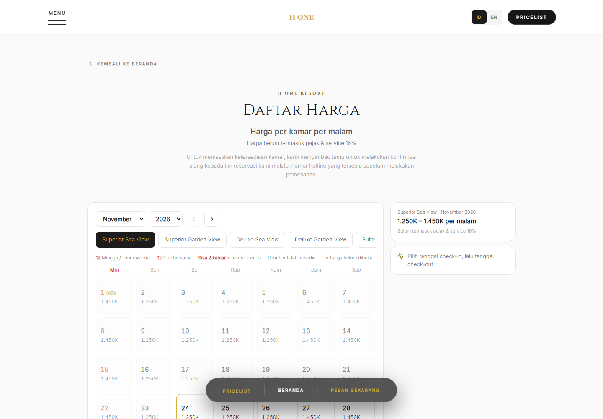

# H One Resort website and booking engine

A resort website with a real booking flow behind it. Guests pick a room and dates, see the price the database calculates, pay through DOKU, and get a confirmation by email. Staff manage everything from a separate [admin panel](https://github.com/Mas-Hanafi/hone-resort-admin).

The front end is a React single-page site. The back end is two Vercel serverless functions on top of a Supabase Postgres database, where most of the booking rules live as SQL functions.




## What it does

- Marketing pages with a hero, rooms, gallery, meeting packages, signature experiences and testimonials. Indonesian and English, with SEO meta tags prerendered at build time and JSON-LD in the page head.
- A price calendar that shows the nightly rate for every day, marks holidays, and tells guests how many rooms are left.
- Online checkout. A guest chooses a room type, stay dates, party size and add-ons, applies a voucher if they have one, and pays. The room is held for a configurable number of minutes while they do.
- Payment through DOKU Checkout. The adapter signs requests with HMAC-SHA256, verifies the signature on incoming webhooks against the raw body, and can ask DOKU for a payment's status directly. Midtrans and Xendit adapters exist behind the same interface, plus a mock provider for local work.
- A reconcile endpoint that a database cron job calls every three minutes, so a payment still completes when a bank never sends a notification.
- Confirmation emails through Resend, a printable A4 receipt, and a booking status page the guest can reopen with their booking code.
- Cloudflare Turnstile on checkout to keep bots out.
- A WhatsApp fallback when online payment is switched off.

## How a booking moves through the system

1. The browser asks `/api/booking/availability` and `/api/booking/quote`. Both call SQL functions, so the page never calculates a price on its own.
2. `/api/booking/create` checks the Turnstile token, then calls `booking_insert`, which locks the stock, applies the voucher quota, and writes the booking as `menunggu_bayar` with a hold expiry.
3. The same call starts a DOKU checkout session and returns its URL. If DOKU is down, the booking is already saved and the guest lands on the status page, where `/api/booking/pay` retries without taking a second hold.
4. DOKU calls `/api/payment/webhook`. The function verifies the signature, marks the payment, and sends the emails. The reconcile job covers any notification that never arrives.

Prices resolve in a fixed order: a manual price for a day wins over a rule set, which wins over the base price of the period.

## Stack

| Layer | Tools |
|---|---|
| Front end | React 18, TypeScript, Vite 5, Tailwind CSS 3, React Router 7, react-day-picker, Splide, Lenis |
| API | Vercel serverless functions in TypeScript (`api/booking`, `api/payment`, shared code in `api/_lib`) |
| Database | Supabase Postgres: 31 migrations, more than 30 SQL functions, row level security, `pg_cron` and `pg_net` |
| Payments | DOKU Checkout, with Midtrans, Xendit and mock adapters |
| Email and bot protection | Resend, Cloudflare Turnstile |

## Repository layout

```
api/
  booking/[action].ts      availability, quote, create, pay, status
  payment/[action].ts      webhook, reconcile, mock
  _lib/                    DOKU client, payment providers, db helper, email
src/                       checkout, price calendar, i18n, stay rules, SEO data
hone_resort.tsx            main landing page
supabase/migrations/       schema, pricing, vouchers, reports, cron
supabase/tests/            SQL tests, each wrapped in begin ... rollback
docs/booking-engine-contract.md   database to API contract
```

## Run it locally

You need Node 24 and npm.

```bash
npm ci
npm run dev
```

The site renders without a backend, using fallback prices. Checkout shows a notice that online payment is off until you connect Supabase and set `BOOKING_ENGINE=on` and `VITE_BOOKING_ENGINE=on`.

Checks that need no external service:

```bash
node api/_lib/payment.check.ts   # DOKU signatures, webhook verification, retries, provider selection
node src/stay.check.ts           # stay rules: minimum nights, closed days, check-out on closed days
npm run build
```

## Connect the backend

1. Create a Supabase project and run `supabase/migrations/*.sql` in file name order. Try it on an empty project first. `20260924f_prod_admin_security.sql` was written for an older production schema, so skip it if it errors.
2. Generate a booking secret and store its SHA-256 in `private.booking_config`. The value itself goes in the `BOOKING_SECRET` environment variable.
3. Register your admin user in `private.admins` with the `owner` role.
4. Copy `.env.example` into your Vercel project settings and fill in the Supabase and booking variables.
5. For payments, create a DOKU sandbox account and set `PAYMENT_PROVIDER=doku`, `DOKU_ENV=sandbox`, `DOKU_CLIENT_ID` and `DOKU_SECRET_KEY`. Set the payment notification URL in the DOKU dashboard to `https://your-domain/api/payment/webhook`.
6. In `20260928b_reconcile_cron.sql`, change the URL to your own domain before you run it.

## Placeholders to replace

| Placeholder | Where |
|---|---|
| `hone.example`, `images.hone.example` | domain, email addresses, SEO files |
| `YOUR-STAGING-REF`, `YOUR-PROD-REF` | Supabase project references in `vercel.json` (CSP) and the migrations |
| `G-XXXXXXXXXX`, `YOUR_GOOGLE_PLACE_ID` | analytics in `index.html`, ratings in `api/google-rating.ts` |
| `6280000000000` | WhatsApp number |
| `Kota Contoh`, `Jl. Contoh No. 1` | address and location copy |

Photos in `public/img` are generated gradients and `public/media/hero.mp4` is a short generated clip. Swap them for your own media. The room copy, prices and testimonials are sample content.

## Status and limits

- The booking engine was exercised end to end against the DOKU sandbox (create, pay, webhook, paid status) in its original deployment. It had not been switched on for real guests when this copy was made.
- This repository has not been run against a fresh Supabase project, so expect to fix small things in the first migration pass.
- Only DOKU has been tested against a live sandbox. The Midtrans and Xendit adapters are covered by unit checks only.
- Some DOKU channels send no notification (certain virtual accounts, QRIS). The reconcile job exists for that reason.
